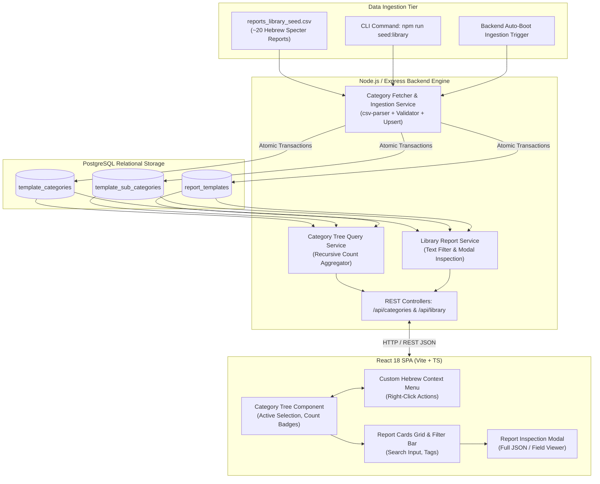
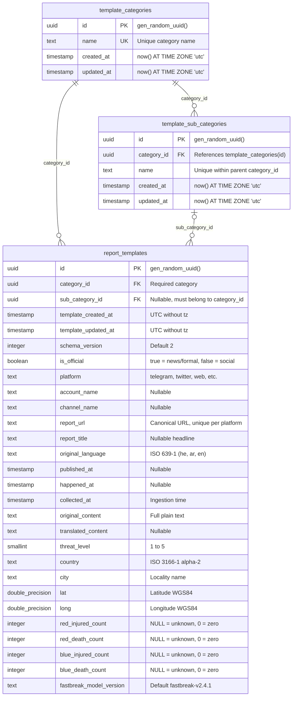
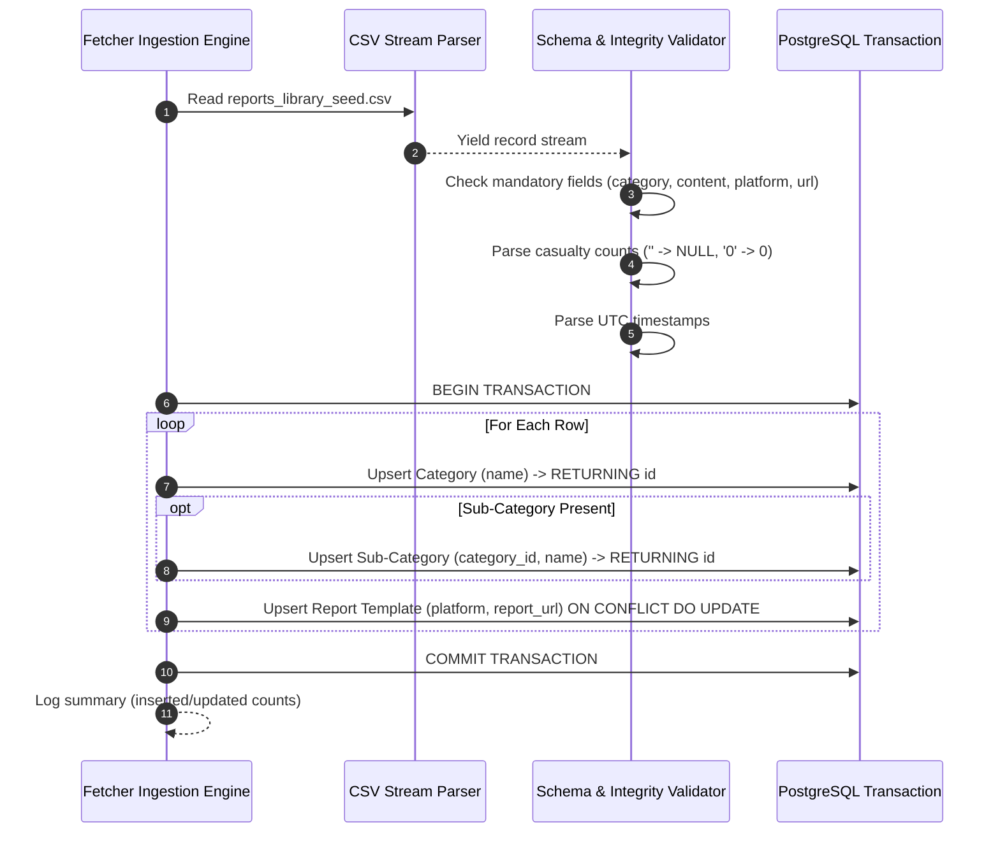
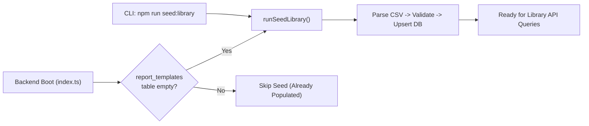

# COBRA Category Fetcher & Content Library: Detailed Architectural & Implementation Plan

> **Specification Status:** Baselined & Approved via `/grill-me` Architectural Discovery  
> **Target Subsystem:** COBRA Content Catalog, Category Fetcher Pipeline, and Library Browser  
> **Source Documents:** `COBRA.md`, `docs/glossary.md`, and ADRs 0001–0007  

---

## Executive Summary
This document specifies the end-to-end design and concrete implementation plan for the **Category Fetcher** and **Content Library** in COBRA. The system enables training officers to browse, search, and manage a curated catalog of ~20 Hebrew Specter scenario report templates, navigate an interactive two-level category tree with real-time report count badges, edit categories/sub-categories via right-click context menus, and reliably seed baseline data from CSV with full idempotency.

---

## Table of Contents
1. [A. Requirements](#a-requirements)
2. [B. Architecture & System Context](#b-architecture--system-context)
3. [C. Data Model & PostgreSQL Schema](#c-data-model--postgresql-schema)
4. [D. Fetcher & Ingestion Engine Behavior](#d-fetcher--ingestion-engine-behavior)
5. [E. Backend & API Impact](#e-backend--api-impact)
6. [F. Frontend Impact & User Experience](#f-frontend-impact--user-experience)
7. [G. Seed & Data Flow](#g-seed--data-flow)
8. [H. Edge Cases & Defensive Safeguards](#h-edge-cases--defensive-safeguards)
9. [I. Concrete Implementation Task Breakdown](#i-concrete-implementation-task-breakdown)
10. [J. Testing Strategy & Quality Assurance](#j-testing-strategy--quality-assurance)

---

## A. Requirements

### 1. Confirmed Functional Requirements
- **FR-01 (Seed Ingestion):** Ingest static library content (~20 Hebrew Specter scenario reports) from CSV into PostgreSQL (`template_categories`, `template_sub_categories`, and `report_templates`).
- **FR-02 (Hierarchical Category Tree):** Expose a two-level hierarchical category tree (`Category -> Sub-Category`) with live aggregate report counts.
- **FR-03 (Parent Count Aggregation):** Parent category count must equal the total number of report templates directly assigned to it plus all report templates assigned to its child sub-categories.
- **FR-04 (Library Report Browsing):** Provide filtered report listing by category, sub-category, and free-text search across Hebrew report titles, original content, and cities.
- **FR-05 (Report Inspection Modal):** Enable clicking on a report card in the frontend to open a detailed modal showing the report content, threat level, platform, published date, casualty breakdown, and coordinates.
- **FR-06 (Right-Click Context Menu):** Desktop-grade context menu on the category tree supporting:
  - Add sub-category under a parent.
  - Rename category or sub-category.
  - Move sub-category to another parent category.
  - Delete category or sub-category.
  - Add new root category from empty area.
- **FR-07 (Restrictive Deletion):** Deletion of any category containing sub-categories or reports, or any sub-category containing reports, must be strictly blocked with an explanatory error.
- **FR-08 (Dual Trigger Execution):** Automated seed verification on backend boot (seeds only if template table is empty) plus a standalone CLI command (`npm run seed:library`) for CI/CD, testing, or explicit re-seeding.

### 2. Operational & Data Integrity Constraints (from `COBRA.md`)
- **CON-01 (Casualty Semantics):** Strictly preserve `NULL` vs `0` distinction for `red_injured_count`, `red_death_count`, `blue_injured_count`, and `blue_death_count`. Never coerce `NULL` to `0`.
- **CON-02 (UTC Timestamps):** All timestamps in DB and API transport must be plain UTC timestamps (`timestamp without time zone` in Postgres, ISO-8601 UTC strings in JSON).
- **CON-03 (Reality Segregation):** While templates are reality-agnostic source blueprints, any simulation reports generated from them must strictly enforce `reality_id != 0`.
- **CON-04 (Idempotency):** The fetcher must be safely re-runnable without duplicating categories, crashing, or wiping manual UI modifications.

### 3. Decisions Log (Summary of ADRs 0001–0007)
| ADR ID | Decision Title | Selected Option |
| :--- | :--- | :--- |
| **ADR-0001** | Scope & Boundary | Complete end-to-end category pipeline (Seed Ingestion + High-Performance Query Service). |
| **ADR-0002** | Seed Ingestion Format | Extend library seed CSV with explicit `category` and `sub_category` columns. |
| **ADR-0003** | Fetcher Idempotency | Non-destructive upsert by natural keys (`name`, `category_id + name`, `platform + report_url`). UI edits preserved. |
| **ADR-0004** | Hierarchy & Ordering | Fixed 2-level hierarchy, alphabetical sorting, parent counts rollup sub-category counts. |
| **ADR-0005** | Deletion & Relocation | Restrictive deletion (block if non-empty). Moving a sub-category cascade-updates report parent references in one transaction. |
| **ADR-0006** | Execution Strategy | Dual trigger: auto-seed on backend boot if empty + CLI command `npm run seed:library`. |
| **ADR-0007** | API & Context Menu | RESTful CRUD + `/api/categories/tree` + `/api/library/reports`, Hebrew context menu. |

---

## B. Architecture & System Context

The Category Fetcher sits between the static scenario seed assets, the PostgreSQL datastore, and the frontend library browser.



### Subsystem Boundaries
1. **Category Ingestion Engine:** Parses the CSV, validates types/nullabilities, resolves natural keys, and writes to PostgreSQL. Does not interact with Kafka or the runtime simulation scheduler.
2. **Category Query Engine:** Computes real-time counts directly via SQL `GROUP BY` and left joins, eliminating cached-count drift.
3. **Frontend Presentation:** Manages tree state, context menu coordinates, active category filter, and modal viewing state.

---

## C. Data Model & PostgreSQL Schema

The data model directly adheres to `COBRA.md` Section 8.4, enforcing referential integrity, plain UTC timestamps, and casualty nullability semantics.



### Relational Table DDL (from `backend/migrations/0002_create_template_library.sql`)

The database tables are already created via `node-pg-migrate` in `backend/migrations/0002_create_template_library.sql`:

```sql
-- 1. Root Categories
CREATE TABLE template_categories (
    id   uuid PRIMARY KEY DEFAULT gen_random_uuid(),
    name text NOT NULL,

    CONSTRAINT template_categories_name_key UNIQUE (name)
);

-- 2. Sub-Categories (with composite unique key and cascade on category delete)
CREATE TABLE template_sub_categories (
    id          uuid PRIMARY KEY DEFAULT gen_random_uuid(),
    category_id uuid NOT NULL,
    name        text NOT NULL,

    CONSTRAINT template_sub_categories_category_id_fkey
        FOREIGN KEY (category_id) REFERENCES template_categories (id) ON DELETE CASCADE,
    CONSTRAINT template_sub_categories_category_id_name_key UNIQUE (category_id, name),
    CONSTRAINT template_sub_categories_category_id_id_key UNIQUE (category_id, id)
);

-- 3. Report Templates (Specter Scenario Content)
CREATE TABLE report_templates (
    id                      uuid      PRIMARY KEY DEFAULT gen_random_uuid(),
    category_id             uuid      NOT NULL,
    sub_category_id         uuid,
    template_created_at     timestamp NOT NULL DEFAULT (now() AT TIME ZONE 'utc'),
    template_updated_at     timestamp NOT NULL DEFAULT (now() AT TIME ZONE 'utc'),

    schema_version          integer   NOT NULL,
    is_official             boolean   NOT NULL,
    platform                text      NOT NULL,
    account_name            text,
    channel_name            text,
    report_url              text      NOT NULL,
    report_title            text,
    original_language       text,
    published_at            timestamp,
    happened_at             timestamp,
    collected_at            timestamp NOT NULL,
    original_content        text      NOT NULL,
    translated_content      text,
    threat_level            integer,
    country                 text,
    city                    text,
    lat                     double precision,
    long                    double precision,
    red_injured_count       integer,
    red_death_count         integer,
    blue_injured_count      integer,
    blue_death_count        integer,
    fastbreak_model_version text,

    CONSTRAINT report_templates_category_id_fkey
        FOREIGN KEY (category_id) REFERENCES template_categories (id) ON DELETE RESTRICT,
    -- Composite FK guarantees sub-category belongs to category
    CONSTRAINT report_templates_sub_category_fkey
        FOREIGN KEY (category_id, sub_category_id)
        REFERENCES template_sub_categories (category_id, id) ON DELETE RESTRICT,

    CONSTRAINT report_templates_threat_level_check CHECK (threat_level BETWEEN 0 AND 100),
    CONSTRAINT report_templates_original_language_check CHECK (original_language ~ '^[a-z]{2}$'),
    CONSTRAINT report_templates_country_check CHECK (country ~ '^[A-Z]{2}$'),
    CONSTRAINT report_templates_lat_check CHECK (lat BETWEEN -90 AND 90),
    CONSTRAINT report_templates_long_check CHECK (long BETWEEN -180 AND 180),
    CONSTRAINT report_templates_counts_check CHECK (
        red_injured_count >= 0 AND red_death_count >= 0
        AND blue_injured_count >= 0 AND blue_death_count >= 0
    )
);

-- Existing Index for Fast Tree Count Calculations
CREATE INDEX report_templates_category_id_sub_category_id_idx
    ON report_templates (category_id, sub_category_id);

-- Auto-update trigger for template_updated_at
CREATE TRIGGER report_templates_set_updated_at
    BEFORE UPDATE ON report_templates
    FOR EACH ROW EXECUTE FUNCTION set_updated_at('template_updated_at');
```

#### Migration Gap & Alignment Notes
1. **Uniqueness on `report_templates`:** Unlike `reports` (which has `UNIQUE (reality_id, platform, report_url)`), `report_templates` does NOT currently have a `UNIQUE (platform, report_url)` constraint. For the Category Fetcher to perform native SQL `ON CONFLICT (platform, report_url) DO UPDATE`, a unique constraint or index is required, or the fetcher can use a lookup-before-upsert transaction. Adding `CREATE UNIQUE INDEX report_templates_platform_report_url_key ON report_templates (platform, report_url);` in a new migration (0005) is recommended for strict database-level idempotency.
2. **Regex CHECK Constraints:** `original_language` must strictly match `^[a-z]{2}$` (e.g. `'he'`), and `country` must strictly match `^[A-Z]{2}$` (e.g. `'IL'`). The CSV seed parser must enforce uppercase country codes and lowercase 2-letter language codes to prevent check constraint violations.
3. **Cascade on Category Deletion:** `template_sub_categories` specifies `ON DELETE CASCADE` from `template_categories`. However, `report_templates` has `ON DELETE RESTRICT` for both `category_id` and `(category_id, sub_category_id)`. Therefore, a category with templates is protected by the database, but an empty category will cascade-delete its empty sub-categories. The API layer will enforce our agreed restrictive policy to protect users from accidental cascades.


---

## D. Fetcher & Ingestion Engine Behavior

### 1. Ingestion Input Contract
The seed loader consumes `backend/src/seed/reports_library_seed.csv`. The CSV extends `enriched_reports_schema-v2.csv` with `category` and `sub_category`:

```csv
category,sub_category,schema_version,is_official,platform,account_name,channel_name,report_url,report_title,original_language,published_at,collected_at,original_content,translated_content,threat_level,happened_at,country,city,lat,long,red_injured_count,red_death_count,blue_injured_count,blue_death_count,fastbreak_model_version
```

### 2. Processing Pipeline


### 3. Parsing & Validation Rules
1. **Casualty Count Sanitization:**
   ```typescript
   function parseCasualtyCount(val: string | undefined): number | null {
     if (val === undefined || val === null || val.trim() === '') return null;
     const parsed = parseInt(val.trim(), 10);
     if (isNaN(parsed)) return null;
     return parsed; // Exactly preserves 0 as integer 0
   }
   ```
2. **Keyword Array Parsing:** Split by semicolon `;`, trim whitespace, discard empty strings (e.g. `"אר\"ן;ירי;מרכז"` -> `["אר\"ן", "ירי", "מרכז"]`).
3. **Timestamp Normalization:** Validate ISO-8601 strings; convert to UTC Date before DB insertion.

---

## E. Backend & API Impact

### 1. Express Router & Endpoints
All endpoints are exposed under `/api`:

| Method | Path | Description | Response Status |
| :--- | :--- | :--- | :--- |
| `GET` | `/api/categories/tree` | Returns two-level tree with live report counts | `200 OK` |
| `GET` | `/api/categories` | Returns the category tree (compatibility alias) | `200 OK` |
| `POST` | `/api/categories` | Create new root category (`{ name }`) | `201 Created` / `409 Conflict` |
| `PATCH` | `/api/categories/:id` | Rename root category (`{ name }`) | `200 OK` / `404 Not Found` |
| `DELETE`| `/api/categories/:id` | Delete category (blocked if items > 0) | `204 No Content` / `409 Conflict` |
| `POST` | `/api/categories/:id/sub-categories` | Create sub-category under category | `201 Created` / `409 Conflict` |
| `GET` | `/api/categories/:id/sub-categories` | List a category's sub-categories | `200 OK` |
| `PATCH` | `/api/categories/:categoryId/sub-categories/:subCategoryId` | Rename sub-category within its parent | `200 OK` / `404 Not Found` |
| `DELETE` | `/api/categories/:categoryId/sub-categories/:subCategoryId` | Delete empty sub-category within its parent | `204 No Content` / `409 Conflict` |
| `GET` | `/api/sub-categories?category_id=` | List sub-categories, optionally by parent | `200 OK` |
| `POST` | `/api/sub-categories` | Create sub-category (`{ category_id, name }`) | `201 Created` / `409 Conflict` |
| `PATCH` | `/api/sub-categories/:id` | Rename or move sub-category (`{ name?, category_id? }`) | `200 OK` / `404 Not Found` |
| `DELETE`| `/api/sub-categories/:id` | Delete sub-category (blocked if reports > 0) | `204 No Content` / `409 Conflict` |
| `GET` | `/api/templates` | List/filter templates (`?category_id=&sub_category_id=&search=`) | `200 OK` |
| `GET` | `/api/templates/:id` | Read a template | `200 OK` / `404 Not Found` |
| `POST` | `/api/templates` | Create a template | `201 Created` / `400 Bad Request` |
| `PATCH` | `/api/templates/:id` | Update a template | `200 OK` / `404 Not Found` |
| `DELETE` | `/api/templates/:id` | Delete a template | `204 No Content` / `404 Not Found` |
| `GET` | `/api/library/reports` | List report template cards (`?category_id=&sub_category_id=&search=`) | `200 OK` |
| `GET` | `/api/library/reports/:id` | Get full report template details for view modal | `200 OK` / `404 Not Found` |

> **Authorization boundary:** The current repository does not yet implement the Keycloak/Mirage auth middleware described in `COBRA.md`. The frontend can hide write controls with `VITE_LIBRARY_WRITE_ENABLED=false`, but API write routes are not role-protected until that middleware is integrated. Do not expose these mutation routes to untrusted networks before then.

### 2. High-Performance Category Tree SQL Query
The query calculates parent and child counts in a single efficient query using a Common Table Expression (CTE):

```sql
WITH sub_cat_counts AS (
    SELECT 
        s.id AS sub_category_id,
        s.category_id,
        s.name AS sub_category_name,
        COUNT(r.id)::int AS report_count
    FROM template_sub_categories s
    LEFT JOIN report_templates r ON r.sub_category_id = s.id
    GROUP BY s.id, s.category_id, s.name
),
cat_total_counts AS (
    SELECT 
        c.id AS category_id,
        c.name AS category_name,
        COUNT(r.id)::int AS total_report_count
    FROM template_categories c
    LEFT JOIN report_templates r ON r.category_id = c.id
    GROUP BY c.id, c.name
)
SELECT 
    c.category_id AS id,
    c.category_name AS name,
    c.total_report_count AS report_count,
    COALESCE(
        json_agg(
            json_build_object(
                'id', s.sub_category_id,
                'name', s.sub_category_name,
                'report_count', s.report_count
            ) ORDER BY s.sub_category_name
        ) FILTER (WHERE s.sub_category_id IS NOT NULL),
        '[]'::json
    ) AS sub_categories
FROM cat_total_counts c
LEFT JOIN sub_cat_counts s ON s.category_id = c.category_id
GROUP BY c.category_id, c.category_name, c.total_report_count
ORDER BY c.category_name;
```

---

## F. Frontend Impact & User Experience

### 1. View Layout: Content Library (`/library`)
The UI follows the layout established in the prototype and `COBRA.md`:

```
┌────────────────────────────────────────────────────────────────────────────────────────┐
│  COBRA Header                                                             [User / Role]│
├──────────────────────────┬─────────────────────────────────────────────────────────────┤
│  קטגוריות ותבניות (Tree)  │  מאגר דיווחים (Cards Grid)                                   │
│  [+ הוסף קטגוריה]        │  🔍 [חיפוש חופשי בתוכן, כותרת, עיר...]                       │
│                          ├─────────────────────────────────────────────────────────────┤
│  ▾ פח"ע וטרור        (8) │  ┌───────────────────────┐   ┌───────────────────────────┐  │
│    • ירי רקטי        (5) │  │ 🚨 ירי לעבר שדרות      │   │ 💥 דיווח ראשוני: פיצוץ    │  │
│    • פיגוע דקירה     (3) │  │ טלגרם · חדשות 12       │   │ טוויטר · OSINT IL         │  │
│                          │  │ רמת איום: 4 | 12:45    │   │ רמת איום: 5 | 13:10       │  │
│  ▸ אסונות טבע        (4) │  │ נפגעים: 2 | הרוגים: 0  │   │ נפגעים: לא דווח           │  │
│  ▸ סדר ציבורי        (8) │  └───────────────────────┘   └───────────────────────────┘  │
│                          │  ┌───────────────────────┐                                  │
│  [Right-Click Menu on]   │  │ 🛑 חסימת כביש 4        │                                  │
│  [Categories / Subs]     │  │ פייסבוק · תנועה        │                                  │
└──────────────────────────┴──┴───────────────────────┴──────────────────────────────────┘
```

### 2. Hebrew Right-Click Context Menu
A custom React portal renders on `contextmenu` events at `(event.clientX, event.clientY)`:
- Prevents the native browser context menu via `e.preventDefault()`.
- Closes automatically on window click or Escape key.
- Disables the "Delete" option if `report_count > 0` with a hover tooltip explaining why.

### 3. Report Modal Inspector
Clicking any report card opens a modal overlay displaying:
- **Header:** Report title, platform badge, threat level badge (color-coded 1–5), official/unverified indicator.
- **Content:** Hebrew plain text and translated text.
- **Operational Metrics:** Casualty table strictly rendering `NULL` as `"לא דווח"` and `0` as `"0"`.
- **Geographic Data:** City, Country, Latitude, Longitude, with link/map coordinates.
- **Metadata:** Canonical URL, Account/Channel, Happened-at vs Collected-at timestamps in IST format.

---

## G. Seed & Data Flow

### 1. Baseline Seed Reports (~20 Hebrew Specter Scenarios)
The seed file `backend/src/seed/reports_library_seed.csv` is populated with realistic operational Hebrew reports covering:
1. **פח"ע וטרור (Terrorism & Hostile Actions):**
   - ירי רקטי: שדרות, אשקלון, גוש דן (3 reports).
   - פיגועי דקירה ודריסה: ירושלים, צומת תפוח (3 reports).
   - חדירת כטב"ם / רחפן נפץ: גליל עליון (2 reports).
2. **אסונות טבע ומזג אוויר (Natural Disasters):**
   - שריפות יער: הרי ירושלים, כרמל (2 reports).
   - שיטפונות והצפות: נחלי הדרום, ואדי ערה (2 reports).
3. **אירועי חומרים מסוכנים ותעשייה (HAZMAT & Industrial):**
   - דליפת אמוניה / חומרים רעילים: מפרץ חיפה (2 reports).
   - פיצוץ במפעל תעשייתי: אזור תעשייה נאות חובב (2 reports).
4. **הפרות סדר ומחאות (Civil Unrest):**
   - חסימות צירים והצתת צמיגים: כביש 1, איילון (2 reports).
   - התפרעות אלימה ועימותים: מזרח ירושלים (2 reports).

### 2. Seed Execution Flow


---

## H. Edge Cases & Defensive Safeguards

| Scenario / Edge Case | System Behavior & Mitigation |
| :--- | :--- |
| **Empty Category / Sub-Category** | Valid state. Rendered with badge `(0)`. Can be deleted via right-click without restrictions. |
| **Duplicate Category Name** | Database `UNIQUE (name)` constraint rejects duplicates. Seed loader reuses existing record. API returns `409 Conflict`. |
| **Duplicate Sub-Category Name** | Allowed across different parent categories; rejected under the same parent via `UNIQUE (category_id, name)`. |
| **Deleting Category with Reports** | Blocked by API with `409 Conflict` ("Category contains X items"). Frontend disables delete button. |
| **Moving Sub-Category to Another Parent** | Atomic transaction: updates `template_sub_categories.category_id` and all matching `report_templates.category_id`. |
| **Partial Failure During CSV Seed** | Wrapped in a single `BEGIN ... COMMIT` PostgreSQL transaction. Any fatal parsing error rolls back completely. |
| **Re-running Seed Multiple Times** | Fully idempotent. Matches by `(platform, report_url)` and updates fields; existing category UUIDs are reused. |
| **Casualty Count Ambiguity** | Blank CSV cells parse to `NULL` (displayed as "לא דווח"). `0` parses to integer `0` (displayed as "0"). |
| **Hebrew Text Direction & RTL** | Frontend tree, cards, and modal configure `dir="rtl"` with appropriate font styling. |

---

## I. Concrete Implementation Task Breakdown

### Phase 1: Database Baseline & Uniqueness Migration
- **Task 1.1: Verify Existing Migrations (Already Created)**
  - **Status:** **Completed** via `0001_create_schema.sql` and `0002_create_template_library.sql`.
  - **Details:** Tables `template_categories`, `template_sub_categories`, and `report_templates` are already defined with composite keys, index `idx_report_templates_cat_sub`, and timestamps trigger.
- **Task 1.2: Add Uniqueness Migration for `report_templates` (Optional / Recommended)**
  - **Status:** **Completed** via `0005_add_report_templates_unique_url.sql`.
  - **Details:** Create migration `0005_add_report_templates_unique_url.sql` adding `CREATE UNIQUE INDEX IF NOT EXISTS report_templates_platform_report_url_key ON report_templates (platform, report_url);` to enable native database-level `ON CONFLICT` upserts for the seed fetcher.
  - **Files:** `backend/migrations/0005_add_report_templates_unique_url.sql`.
  - **Complexity:** Very Low.


### Phase 2: Seed Dataset & Ingestion Pipeline
- **Task 2.1: Author Hebrew Seed CSV (~20 Reports)**
  - **Status:** **Completed**; `backend/src/seed/reports_library_seed.csv` is populated.
  - **Details:** Compile `backend/src/seed/reports_library_seed.csv` with ~20 high-fidelity Hebrew Specter reports across 4 categories and 8 sub-categories, adhering to DataForge specifications.
  - **Files:** `backend/src/seed/reports_library_seed.csv`.
  - **Complexity:** Medium.
- **Task 2.2: Implement Seed Ingestion Engine & CLI**
  - **Status:** **Completed**; loader, CLI script, and upsert migration support are present.
  - **Details:** Build `backend/src/seed/categorySeedLoader.ts` using streaming CSV parser, integrity validation, and PostgreSQL upsert transaction. Add `npm run seed:library` script.
  - **Files:** `backend/src/seed/categorySeedLoader.ts`, `backend/package.json`.
  - **Complexity:** Medium.
- **Task 2.3: Integrate Auto-Seed on Startup**
  - **Status:** **Completed**; `backend/src/index.ts` checks for an empty library at boot.
  - **Details:** Add boot verification in `backend/src/index.ts` to trigger seed loader if library is empty.
  - **Files:** `backend/src/index.ts`.
  - **Complexity:** Low.

### Phase 3: Backend Services & REST API
- **Task 3.1: Category Tree Service & Endpoints**
  - **Status:** **Completed**; tree counts, category/sub-category CRUD, restrictive deletes, and transactional moves are implemented. Moving sub-categories requires migration `0006_defer_template_sub_category_fk.sql`.
  - **Details:** Implement `backend/src/services/categoryService.ts` executing the hierarchical count query, and CRUD controllers for categories/sub-categories with restrictive deletion checks.
  - **Files:** `backend/src/services/categoryService.ts`, `backend/src/routes/categoryRoutes.ts`.
  - **Complexity:** Medium.
- **Task 3.2: Report Library Service & Endpoints**
  - **Status:** **Completed**; filtered listing and report detail endpoints are implemented.
  - **Details:** Implement `backend/src/services/libraryReportService.ts` for listing, text filtering, and retrieving single report details.
  - **Files:** `backend/src/services/libraryReportService.ts`, `backend/src/routes/libraryRoutes.ts`.
  - **Complexity:** Low.

### Phase 4: Frontend Category Tree & Context Menu
- **Task 4.1: Category Tree Component**
  - **Status:** **Completed** in `frontend/src/pages/LibraryPage.tsx`; searchable directory tree includes categories, sub-categories, and template leaves.
  - **Details:** Build hierarchical tree view with collapse/expand toggles, active selection state, and count badges.
  - **Files:** `frontend/src/components/library/CategoryTree.tsx`, `CategoryTree.css`.
  - **Complexity:** Medium.
- **Task 4.2: Hebrew Right-Click Context Menu & Modals**
  - **Status:** **Completed**; write controls, add/rename/move/delete dialogs, and restrictive delete feedback are wired to the API.
  - **Details:** Build custom context menu portal handling Add, Rename, Move, and Delete actions with dialog confirmations and form validation.
  - **Files:** `frontend/src/components/library/CategoryContextMenu.tsx`, `CategoryModal.tsx`.
  - **Complexity:** Medium.

### Phase 5: Frontend Cards Grid, Filter Bar & Report Modal
- **Task 5.1: Search Filter & Cards Grid**
  - **Status:** **Completed**; search covers category/sub-category names and template content; cards show location and threat level.
  - **Details:** Build responsive cards grid displaying report cards with threat badges, platform icons, timestamps, and casualty counts.
  - **Files:** `frontend/src/components/library/ReportCardGrid.tsx`, `ReportCard.tsx`.
  - **Complexity:** Medium.
- **Task 5.2: Report Inspection Modal**
  - **Status:** **Completed**; view-only details preserve null-vs-zero casualty values.
  - **Details:** Build modal dialog rendering the full report details, casualty breakdown (`NULL` vs `0`), and geographic coordinates.
  - **Files:** `frontend/src/components/library/ReportDetailModal.tsx`.
  - **Complexity:** Low.
- **Task 5.3: Library Page Assembly & Routing**
  - **Status:** **Completed** at `/` and `/library`; editor supports template creation, update, deletion, and Leaflet coordinate picking.
  - **Details:** Assemble the components into `/library` page in `frontend/src/pages/LibraryPage.tsx` with responsive layout and error/loading states.
  - **Files:** `frontend/src/pages/LibraryPage.tsx`, `frontend/src/App.tsx`.
  - **Complexity:** Low.

---

## J. Testing Strategy & Quality Assurance

### 1. Automated Unit & Integration Tests (Backend)
- **Fetcher Ingestion Unit Tests (`categorySeedLoader.test.ts`):**
  - Verify `parseCasualtyCount` preserves `null` for empty string and `0` for `"0"`.
  - Verify keyword splitting with semicolons.
  - Verify idempotent re-run does not produce duplicate rows or change existing IDs.
- **API Endpoint Integration Tests (`categoryRoutes.test.ts`):**
  - `GET /api/categories/tree`: Verify JSON structure and count aggregation.
  - `DELETE /api/categories/:id`: Verify `409 Conflict` when category contains reports.
  - `PATCH /api/sub-categories/:id`: Verify moving sub-category updates both sub-category and report `category_id`.
  - `GET /api/library/reports?search=...`: Verify Hebrew text filtering returns matching templates.

### 2. Frontend Component & Interaction Tests (Vitest + React Testing Library)
- **Category Tree Tests (`CategoryTree.test.tsx`):**
  - Renders categories with correct report count badges.
  - Fires right-click event and displays Hebrew context menu at cursor position.
  - Clicking a category filters the active report list.
- **Report Modal Tests (`ReportDetailModal.test.tsx`):**
  - Renders "לא דווח" when casualty is `null`.
  - Renders "0" when casualty is `0`.

---
*Approved Architectural Implementation Plan for COBRA Category Fetcher & Library Subsystem*
